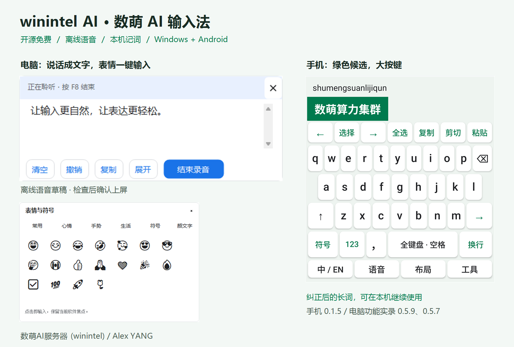
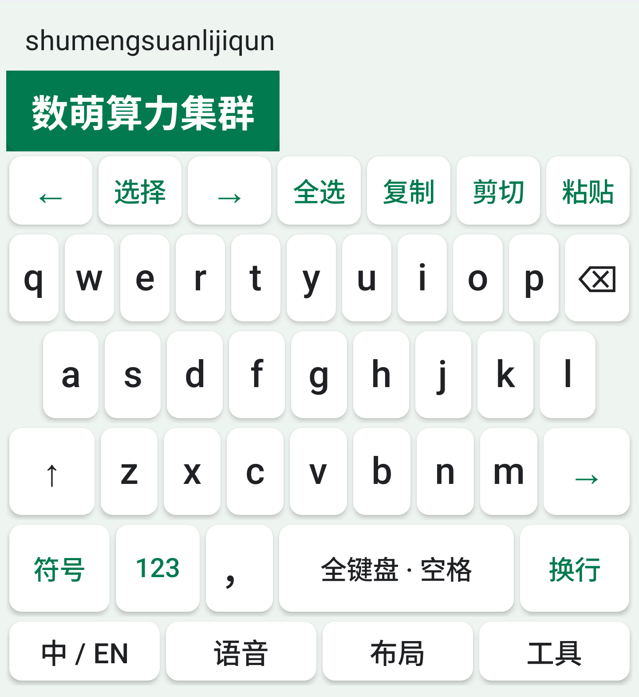
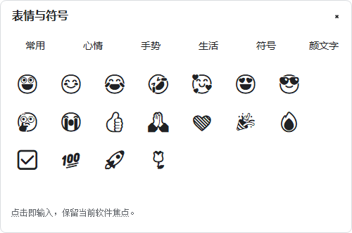
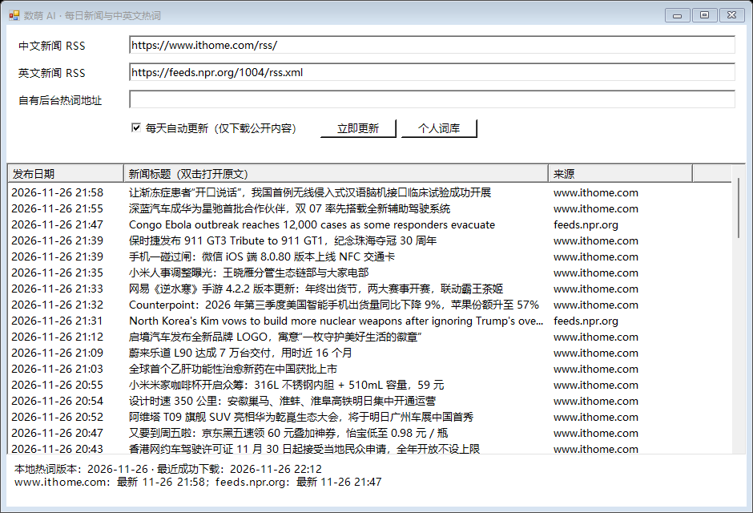

# winintel AI Input Method

An open-source Windows and Android system keyboard with a local pinyin engine, adaptive candidate ranking and offline speech recognition. Core input, correction, ranking and speech processing run locally on the CPU.

[中文说明](README.md) · [Public releases](https://github.com/alexhmyang/winintel-ime/releases) · [Website](https://winintel.com)

Latest release: Windows 0.5.11 / Android 0.1.5. Expanded word data improves long
phrases; candidates use green with white text. Android drafts can be edited
directly, same-editor connection restarts preserve pending Chinese input, and
corrections/new phrases are stored on the device. The keyboard has no Edit or
Send button.

[Windows installer](https://github.com/alexhmyang/winintel-ime/releases/download/v0.5.11/winintel-ime-0.5.11-setup.exe) · [Android APK](https://github.com/alexhmyang/winintel-ime/releases/download/v0.5.11/winintel-ime-android-0.1.5.apk) · [Source, checksums and reports](https://github.com/alexhmyang/winintel-ime/releases/tag/v0.5.11)

## See it in action

[](https://github.com/alexhmyang/winintel-ime/releases/tag/v0.5.11)

| Android | Windows |
|---|---|
| Large keys and green phrase candidates | Offline voice drafts with review before insertion |
| Corrected phrases remembered on the device | Emoji and symbols inserted into the active application |
| Direct draft editing and selection tools | Bilingual news, publication dates and offline caching |

<details>
<summary><b>More real screenshots</b></summary>








Screenshots are cropped from actual running applications. Android: 0.1.5.
Windows voice, emoji and news: 0.5.9, 0.5.7 and 0.5.8 respectively.

</details>

The dictionary contains 1,751,276 full-pinyin and abbreviation index records.
Android adds nine-key and full keyboard layouts, larger keys, direct draft
editing and a newline key. Windows caches long-pinyin segmentation queries to
improve editing responsiveness.

| Verification | Result |
|---|---|
| Android dictionary, T9 and personal words | 18 JVM checks passed with a 192MB heap |
| Final Android APK editing and connection checks | 27 passed |
| Independent Android host interaction | 14 passed, including learned corrections after process restart |
| Windows UI and input | 57 passed, plus 7 engine examples |
| Android signing and page alignment | Existing release signature, v2/v3 and 16KB alignment passed |

Android interaction checks used an x86_64 emulator and an independent test app;
compatibility with individual WeChat versions on physical phones requires
device testing. Upgrade in place to retain personal words; uninstalling or
clearing app data deletes them.

## Windows 0.5.8

The release adds 22,437 English prefix entries. In EN mode, type `hel` and press Tab to complete `hello`; arrow keys select alternatives. Space preserves the typed word and inserts a space. Case, digits, punctuation and host shortcuts are preserved.

The toolbox includes **Daily News and Hotwords** with free IT Home and NPR World feeds, RSS/Atom support, five-minute refresh and offline caching. Your own HTTPS `/v1/news` interface can replace the free sources, with optional fallback. Publication timestamps remain distinct from download times. A bilingual curated pack dated 2026-11-26 adds technical vocabulary; your own server can supply updates at `/v1/hotwords`. Typing stays offline and input/audio are never included in content requests. See [the usage guide](windows/English-news-guide.md).

## Android 0.1.5

[Download APK](https://github.com/alexhmyang/winintel-ime/releases/download/v0.5.11/winintel-ime-android-0.1.5.apk). Android 8.0+, arm64 phones and x86_64 emulators. The updated keyboard shares the local English and Chinese hotword lists with Windows. Type `hel` in EN mode and tap `hello` to complete; Space preserves the original word.

Open News from the home screen or keyboard. News is disabled by default. When enabled, this page refreshes IT Home and NPR every five minutes, with a configurable HTTPS `/v1/news` endpoint, optional fallback and offline cache. Leaving the page stops scheduled refreshes. INTERNET permission is used for news only; typing, learning and speech remain local. The APK uses the existing release signing key for in-place upgrades. Offline voice drafts and notes are included; live translation and SRT export remain Windows features.

## Windows 0.5.7

| Feature | Behavior |
|---|---|
| Pinyin and abbreviation learning | Remembers chosen words and sentences locally; full spelling can teach abbreviations |
| Personal dictionaries | Add names and technical terms, including alternate pronunciations |
| Composition editing | Move the caret, insert/delete in the middle, undo/redo; up to 256 letters |
| Emoji and symbols | Six categories including emoji, math symbols, arrows and kaomoji; preserves input focus |
| Dictionary API | Explicit manual download, encrypted local access key, validated offline cache |
| App assistant | Search WeChat and switch supported applications using explicit commands |
| Sponsored placement | Disabled by default, clearly labeled advertising in the toolbox |
| Offline speech and translation | Voice draft confirmation, bilingual subtitles and meeting export |

Right-click the tray icon to open the toolbox. Focus the target input field before selecting emoji. Use `微信找 张三` to search WeChat, `打开记事本` to open Notepad or `切换到 Excel` to switch to Excel. WeChat must be running and signed in. Navigation uses local accessibility or Windows OCR; ambiguous results require manual selection. Commands never send messages.

Plain text and rich text controls passed Unicode insertion tests, including emoji after pending pinyin. The local WeChat 4.2.0.53 test recognized the search label, but opening a contact conversation has not passed end-to-end validation. The assistant stops when the foreground window changes. Compatibility across individual WeChat, TRAE and Office versions requires application-specific testing.

Voice input starts/stops with F8. A draft beginning with `软件指令` opens the assistant after confirmation; click Execute to perform the action. Other voice drafts are inserted only after confirmation.

Windows includes x64 and x86 TSF components. Elevated applications require matching permissions. Restart existing application windows after upgrading so they load the new DLL. Font support determines emoji appearance.

## Open-source business model

The GPL client and its local features are free. Revenue can come from enterprise dictionary hosting, industry dictionary maintenance, deployment and support. The dictionary server is also open source and self-hostable.

API synchronization downloads dictionaries only when requested. It does not upload typed text, learning history, audio or contact names. Existing caches remain available after a failed download. See [server setup](service/README.md). This release provides the server implementation and client connection; public hosting and online payments are not deployed.

## Build and platforms

Windows builds require Visual Studio C++ Build Tools, Windows SDK, .NET Framework 4.x and NSIS. Install a release to obtain the offline assets, then run:

```powershell
.\windows\BuildRelease.ps1
```

The full source is in this repository. The Android release remains independently versioned; the Windows 0.5.7 toolbox additions are Windows features. See the [Chinese guide](README.md) for Android setup and build instructions.

Application code is GPL-3.0-or-later. Third-party dictionaries, models and runtimes retain their own licenses: [notices](THIRD_PARTY_NOTICES.md).

Author: 数萌AI服务器 (winintel) · service@winintel.com

Copyright (c) 2026 数萌AI服务器 (winintel) / Alex YANG. Preserve applicable copyright and license notices; distribute modified versions with corresponding source as required by the GPL. See [authorship and copyright](AUTHORS.md) for attribution, branding and separate promotional media permissions.
