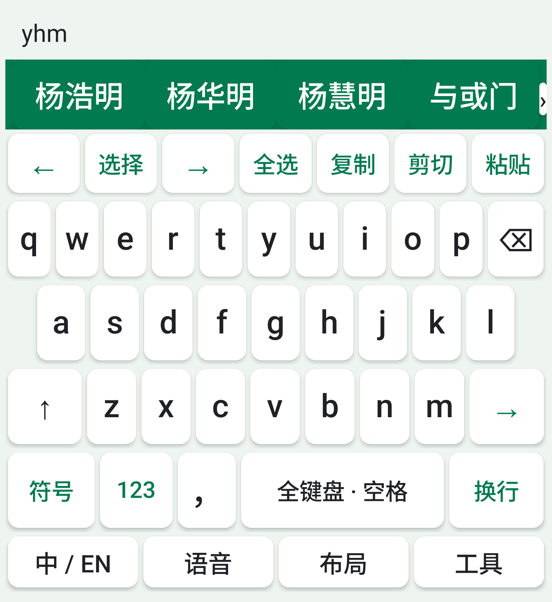
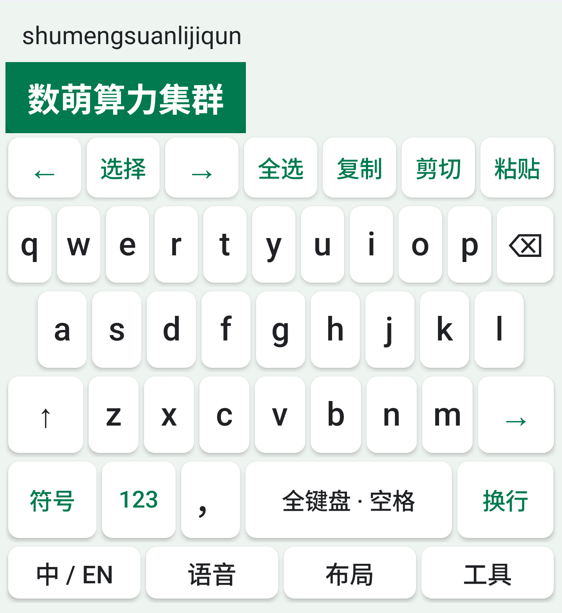

# 数萌 AI 输入法 · Android 0.1.12

[下载安装 APK](https://github.com/alexhmyang/winintel-ime/releases/download/v0.5.17/winintel-ime-android-0.1.12.apk) · [完整项目说明](../README.md)

最新版本修复候选遗漏、键盘布局裁切、展开候选点击区域及长按删除多删；每页最多 25 项，支持九宫格、八大行业词库和本机选词记忆。

Android 8.0+，支持 arm64 手机和 x86_64 模拟器。原生系统键盘、本地拼音词库、22,437 项英文补全、双语精选热词、选词学习、离线 SenseVoiceSmall INT8、语音草稿和文字笔记。

## 看看实际输入效果

**绿色候选、大按键、直接编辑，纠正过的常用词留在本机。**



首次输入 `yhm`，横向滑动候选即可选“杨慧明”；选择一次后重启也会优先显示。图为实际运行截图。



这是 0.1.5 实际运行截图，裁去了测试应用区域。“数萌算力集群”是选区纠正后保存的本机词条，进程重启后仍可再次选到。

## 安装与使用

安装后打开应用，依次点击“启用数萌输入法”“切换到数萌输入法”。键盘点击候选选词，横向滑动查看更多，`›` 翻页，空格选首项。语言按钮切换中英文。

0.1.6 保留 944,740 个不同候选词和 1,833,993 条全拼 / 简拼索引，取消旧版同码 96 / 192 项与查询 90 项的截断。新增离线姓名组合候选，`yhm`、`yanghuiming`、`yanghm`、`yhuiming` 均可选“杨慧明”，也支持九宫格全拼和简拼；选择一次后本机记词优先，重启不丢失。更生僻的字可逐字输入纠正并学习。

候选区采用绿色白字，按键按下变深绿色；中英文、数字、符号类别和语音等状态会高亮。去除“编辑”和“编辑草稿”按钮，直接触摸草稿放置光标并修改；左右移动、选择和剪贴工具直接可用。回车统一为“换行”，不触发应用的发送或完成动作。

同一输入框重启连接时保留待选拼音，延迟的中文光标回调不再清空新一轮输入。选词和选区纠正会记入本机词库，常用词可通过完整拼音、简拼和九宫格查询；连续上屏的中文会组合学习新词。覆盖安装保留记录，卸载或清除应用数据会删除个人词库。精选词包是随版本提供的离线词表，新闻刷新不等于自动更新公共词库。

授权麦克风后点击“语音”，停顿后识别，再次点击停止；确认草稿后上屏。首页可以保存文字笔记。音频只在内存中处理；密码框禁用语音并不学习选词。隐藏键盘或离开输入目标会取消当前录音和迟到回调。

EN 模式输入 `hel`，点击候选 `hello` 完成补全；Space 提交原词与空格。首字母大写或全大写保持对应格式；密码框不启用补全和学习。

首页和键盘有“新闻”入口，默认关闭。启用后在新闻页面每 5 分钟获取免费 IT之家 / NPR 新闻，离开页面停止定时刷新。可填写自有 HTTPS `/v1/news`，选择是否失败回退免费源。失败保留离线缓存，文章发布日期和下载时间分开显示；点击条目在浏览器打开原文。API 格式为 `{"schema":1,"items":[{"title":"标题","url":"https://example.com/article","source":"https://example.com","published_at":"2026-11-26T12:00:00Z"}]}`，最多 200 条 / 2 MB。

新增 INTERNET 权限只供主动开启的新闻使用，输入、选词历史和录音不上传。使用原发布签名，可直接覆盖旧版安装并保留个人选词。更新后的词库会自动使用新版缓存。Android 与 Windows 独立编号；语音仍采用停顿后处理，实时翻译与 SRT 功能由 Windows 提供。

## 编译

需要 JDK 17+、Node.js 22+。SDK 35、sherpa-onnx 2.0.3 AAR 和 Kotlin stdlib 1.9.24 由准备脚本下载并缓存在源码目录外；模型从官方 APK 提取并校验。

```powershell
.\tools\PrepareRelease.ps1 -PublishedApk "D:\downloads\winintel-ime-android-0.1.1.apk"
.\BuildRelease.ps1 -JavaHome "C:\Program Files\Java\jdk-20" `
  -KeyStore "D:\private\release.jks" -PasswordFile "D:\private\password.txt" `
  -Output "D:\packages"
```

密钥别名为 `winintel`，签名密钥与密码文件必须放在仓库外。覆盖安装要求相同签名。脚本自动生成词库、编译 Java / DEX、打包模型和两种 ABI、签名并验证 16 KB 页对齐。

应用代码：GPL-3.0-or-later。模型和运行库遵守各自授权，完整许可在 `licenses` 和安装包 assets 中。
